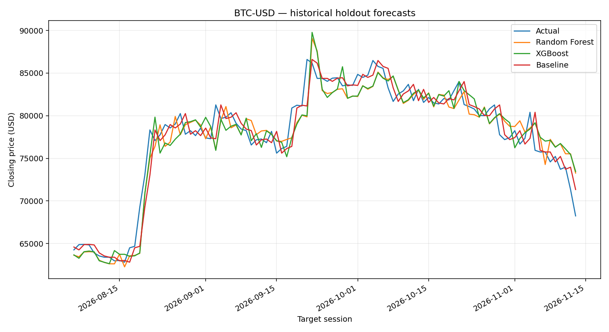
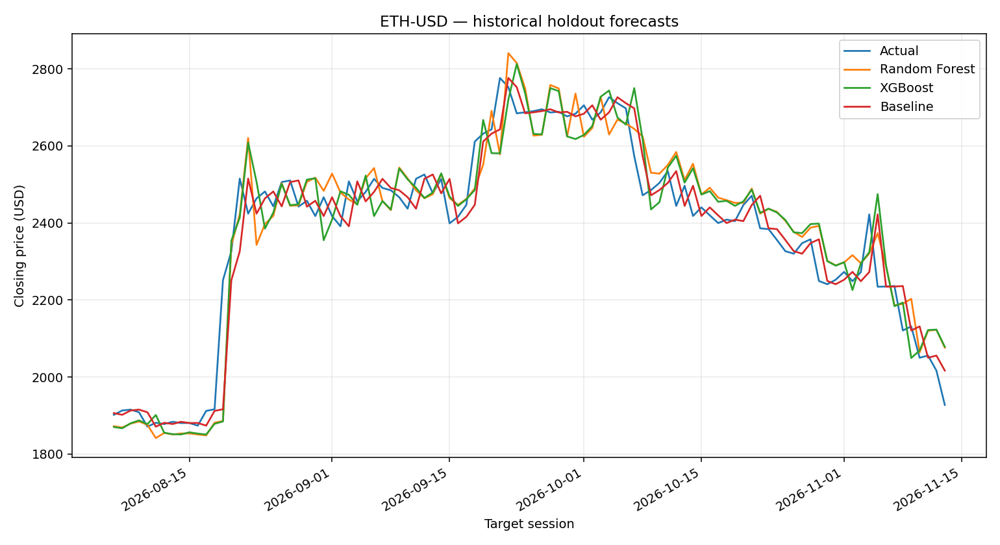
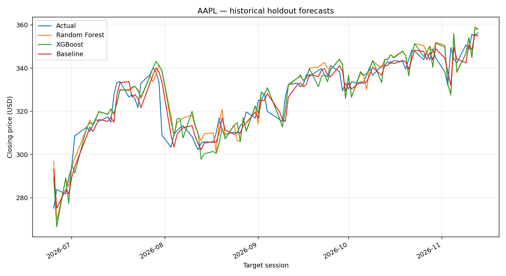
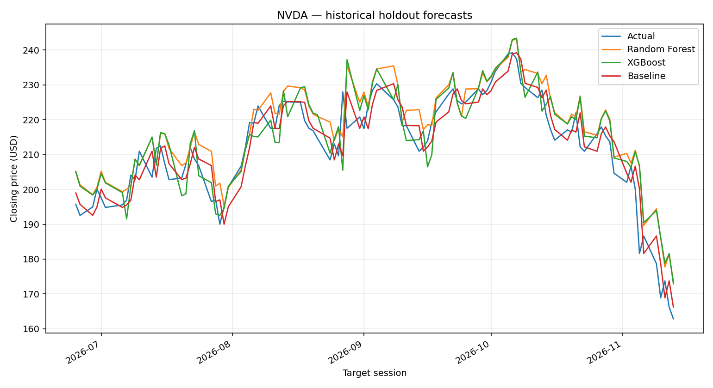
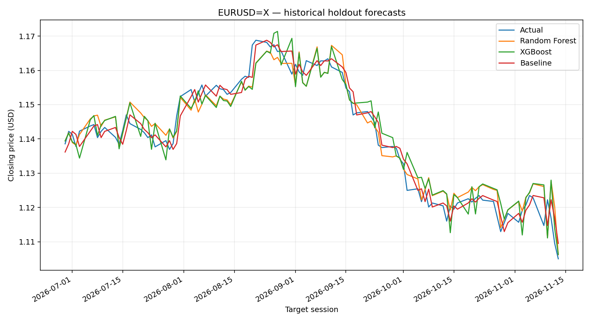
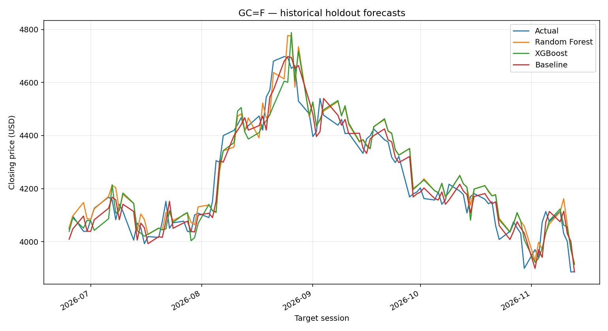

# 📈 AI Market Predictor

**Next-session price and direction forecasts on your laptop.**

Compare Random Forest and XGBoost on daily market data from Yahoo Finance. The project runs on a CPU, saves trained models for reuse, and shows how each model compares with a simple baseline.

| Platform | Python | Data | Compute |
| --- | --- | --- | --- |
| Windows 11 setup | 3.12 (64-bit) | Yahoo Finance via `yfinance` | CPU only, two training threads |

> **Educational only, not financial advice**

## 🚀 Quick start on Windows 11

**This workspace is already set up.** Open PowerShell in this project folder and run:

```powershell
.\.venv\Scripts\python.exe predictor.py --no-show
```

This downloads fresh data, loads the saved BTC-USD models, prints the forecast,
and saves the chart without opening a window. Keep `.python312` in place: this
workspace's Python 3.12 virtual environment depends on it. No activation is needed
when using the explicit `.venv` command.

**For a fresh installation on another computer:**

1. Install [64-bit Python 3.12](https://www.python.org/downloads/).
2. Extract the project and open the folder containing `predictor.py` and `requirements.txt` in VS Code.
3. Open **Terminal → New Terminal**, select **PowerShell**, and run:

```powershell
py -3.12 -m venv .venv
.\.venv\Scripts\python.exe -m pip install --upgrade pip
.\.venv\Scripts\python.exe -m pip install -r requirements.txt
.\.venv\Scripts\python.exe predictor.py
```

The first run downloads five years of daily history for Bitcoin, compares and trains both model families, and opens the historical chart. Later runs for the same ticker load the saved models and fetch fresh data. You’ll need an internet connection for installation and data downloads. Yahoo Finance access through this project requires no API key.

## 🪙 Switch assets

Change the `TICKER` line in [predictor.py](predictor.py), save the file, and run the same command again.

```python
TICKER = "AAPL"
```

| Asset | Yahoo Finance symbol |
| --- | --- |
| Bitcoin | `BTC-USD` |
| Ether | `ETH-USD` |
| Apple | `AAPL` |
| NVIDIA | `NVDA` |
| EUR/USD | `EURUSD=X` |
| Gold futures | `GC=F` |

Other Yahoo Finance symbols work when they have enough usable history and both directions appear in training. Each ticker gets its own saved models.

## 🔎 Read the forecast

The terminal prints the latest usable daily close, the estimated next closing price, the predicted direction, and both probabilities. **UP** means a higher close. **DOWN** includes an unchanged close. Confidence is the larger of the two uncalibrated model probabilities. A 70% reading alone does not establish a 70% success rate.

The forecast covers the next session in the daily data, which can be after a weekend or holiday. The program uses Yahoo’s session metadata to avoid unfinished daily bars. The input close can lag a live quote.

| Output | What it contains |
| --- | --- |
| `output/<ticker-folder>/models.joblib` | Both fitted model families and their evaluation results |
| `output/<ticker-folder>/predicted_vs_actual.png` | Actual closes, both models’ historical estimates, and the last-close baseline |

The chart plots forecasts on the dates they target and shows up to 100 historical holdout sessions. It updates when you retrain. The terminal prints the exact output paths.

## 🧠 How the backtest works

1. **Build features.** Moving averages, RSI, MACD, Bollinger Bands, relative volume, volatility, and lagged returns use data available by the input session’s close.
2. **Compare models in time order.** Three expanding-window folds score both families. A one-session gap keeps the last training target before the first validation input.
3. **Score a separate holdout.** The latest 20% of labeled rows are held out from model selection. The report shows direction accuracy, Brier score for probability error, and mean absolute closing-price error.
4. **Save the fitted models.** The family with the lowest average validation Brier score supplies the forecast. Both families are refit on all labeled rows and saved. Each family pairs a direction classifier with a regressor that estimates the size of the move.

The baseline uses the historical UP rate for probability and the latest known close for its price estimate. Compare the printed holdout results before drawing conclusions: either model can perform worse than this baseline. The holdout evaluates models fitted only on earlier data; the saved forecast models are then refitted on all labeled rows.

## ▶️ Running commands

Run these commands from the folder containing `predictor.py`. An internet
connection is needed on every normal run, including when loading saved models.
Training stays on the CPU with two threads; no GPU is needed.

| Task | PowerShell command |
| --- | --- |
| Run normally | ` .\.venv\Scripts\python.exe predictor.py ` |
| Save the chart without opening a window | ` .\.venv\Scripts\python.exe predictor.py --no-show ` |
| Retrain on the latest available history | ` .\.venv\Scripts\python.exe predictor.py --retrain ` |
| Retrain and save without opening a window | ` .\.venv\Scripts\python.exe predictor.py --retrain --no-show ` |

A successful run prints the latest usable close, estimated next close, UP/DOWN
direction, confidence, both probabilities, the model comparison, and output paths.
Run it again to see `Loaded saved models without retraining.` Use `--retrain`
when you want to refresh fitted models and their historical evaluation.

## 🧪 Test the software and model

### 1. Check the environment

```powershell
.\.venv\Scripts\python.exe --version
.\.venv\Scripts\python.exe -m pip check
```

Expect Python 3.12 and `No broken requirements found.` If dependencies are missing,
run `.\.venv\Scripts\python.exe -m pip install -r requirements.txt`.

### 2. Run offline regression tests

```powershell
.\.venv\Scripts\python.exe -m unittest -v test_predictor
```

Expect six tests followed by `OK`. Deterministic synthetic data checks causal
features, next-session targets, chronological split boundaries, missing volume,
short histories, unfinished bars, probability/price consistency, model reuse,
retraining, and valid PNG output. These tests need no Yahoo connection and use
temporary output files.

### 3. Test all six tickers with Yahoo data

```powershell
.\.venv\Scripts\python.exe -u check_workflows.py
```

This runs the normal workflow with **retraining** for BTC-USD, ETH-USD, AAPL,
NVDA, EURUSD=X, and GC=F. It refreshes their models and charts under `output`,
validates saved files and forecast consistency, and writes `checks_live.json`.
Your `TICKER` setting is unchanged. Inspect each ticker's `status` in the JSON:
the runner records individual failures and continues, so completion alone does
not mean every ticker passed.

If Yahoo is unavailable, test the pipeline offline:

```powershell
.\.venv\Scripts\python.exe check_workflows.py --synthetic
```

This writes `checks_synthetic.json` and puts artifacts in `output/synthetic`,
preserving live models. Synthetic scores test software behavior, not forecasting
skill on real markets.

### 4. Interpret model quality honestly

Compare all three methods on the **same historical holdout**:

| Metric | Meaning | Better result |
| --- | --- | --- |
| Direction accuracy | Fraction of correct UP/DOWN predictions | Higher |
| Brier score | Error in UP probabilities | Lower |
| Closing-price MAE | Average absolute price error in quote units | Lower |

In the recorded live checks, the baseline beat both models on Brier score and
price MAE for all six tickers. Passing software tests does not establish profitable
predictions. Probabilities are **uncalibrated**. Keep the holdout out of tuning;
use earlier validation folds for model selection. See [the debug report](DEBUG_REPORT.md)
for exact scores, commands, and verification limits, or [the live results](checks_live.json)
for machine-readable metrics.

## 🖼️ Output gallery

These are saved charts from the verified runs, copied from `output` into `assets`.
They show actual closes, both models' historical estimates, and the baseline on
their target dates. **These README previews are static snapshots.** Running the
predictor updates `output`; it does not automatically replace the gallery images.
Click a preview to open the full-size image.

### ₿ Bitcoin · BTC-USD

[](assets/BTC-USD_2fd1a09e.png)

### 💠 Ether · ETH-USD

[](assets/ETH-USD_d50cffa2.png)

### 🍎 Apple · AAPL

[](assets/AAPL_1eb44d62.png)

### 🟢 NVIDIA · NVDA

[](assets/NVDA_426219f2.png)

### 💱 EUR/USD · EURUSD=X

[](assets/EURUSD_X_edb0c8f3.png)

### 🥇 Gold futures · GC=F

[](assets/GC_F_652cc40d.png)

## 🛠️ Troubleshooting

- **Python command unavailable.** Reopen the terminal after installing Python and check `py -3.12 --version`.
- **`requirements.txt` missing.** Open the extracted folder that directly contains the project files.
- **Yahoo download fails.** Check the exact symbol on Yahoo Finance and retry when the connection is available. For short histories, choose a symbol with at least 250 usable training rows after indicator warm-up.
- **Chart window fails to open.** Run with `--no-show` and open the saved PNG from File Explorer.

## 📁 Project files

| File | Role |
| --- | --- |
| [requirements.txt](requirements.txt) | Exact direct dependency versions |
| [predictor.py](predictor.py) | Ticker setting, data download, and main entry point |
| [features.py](features.py) | Technical indicators and next-session training targets |
| [train.py](train.py) | Model fitting, chronological evaluation, and baselines |
| [predict.py](predict.py) | Model persistence, forecast output, and chart generation |
| [test_predictor.py](test_predictor.py) | Deterministic offline regression tests |
| [check_workflows.py](check_workflows.py) | Six-ticker live or synthetic workflow checks |
| [DEBUG_REPORT.md](DEBUG_REPORT.md) | Debugging findings and measured performance |
| [assets](assets) | Saved chart previews used in this README |
